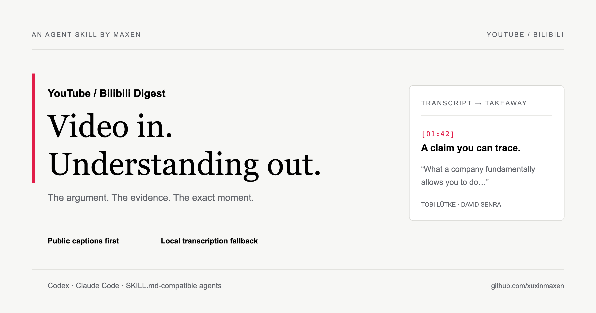
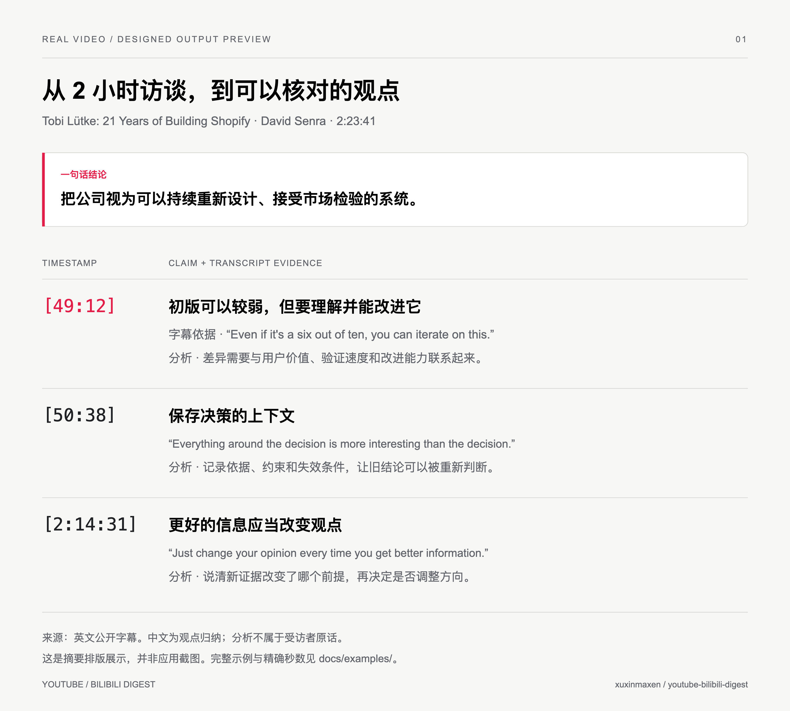
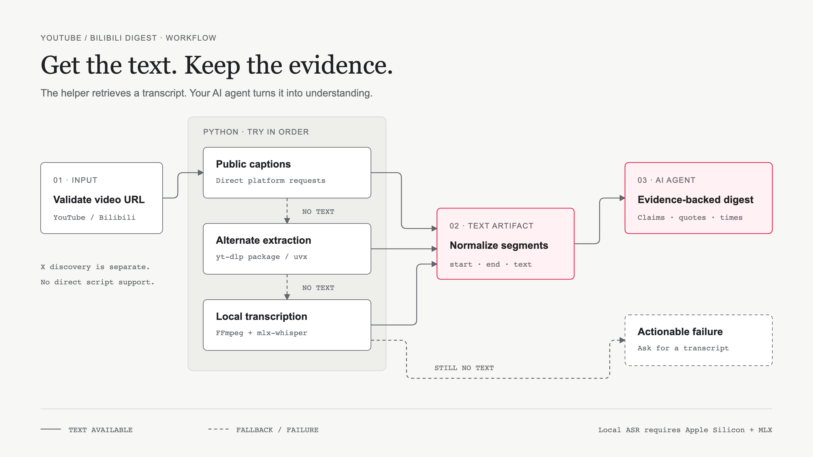

<div align="center">



# YouTube / Bilibili Digest

**Paste a video link. Get the argument, the evidence, and where to find it.**

[中文说明](README.zh-CN.md) · [Real example](docs/examples/tobi-lutke.md) · [How it works](docs/architecture.md) · [Troubleshooting](docs/troubleshooting.md)

[](https://github.com/xuxinmaxen/youtube-bilibili-digest/actions/workflows/ci.yml)
[](LICENSE)
[](https://www.python.org/)

</div>

An agent skill for **Codex, Claude Code, and other SKILL.md-compatible agents**. It retrieves public captions, falls back to local speech recognition when available, and asks your agent to produce a structured summary backed by timestamped transcript evidence. Chinese is the default output language; ask for another language in your prompt.

## See the result



*Designed preview of an actual use case, not an application screenshot. [Read the attributed example and its evidence](docs/examples/tobi-lutke.md).* The fetch script returns transcript JSON; **your AI agent writes the summary**.

## What you get

- A one-sentence takeaway and usually 5–8 key ideas; fewer for short videos.
- Real transcript timestamps alongside short evidence quotes.
- A chapter outline covering the beginning, middle, and end.
- Clear separation of the speaker's claims and the agent's interpretation.
- A source note identifying public captions or local Whisper transcription.
- An actionable failure message when usable text cannot be obtained.

## Install

Clone this repository, then install the **skill subdirectory**, not the repository root:

```bash
git clone https://github.com/xuxinmaxen/youtube-bilibili-digest.git
cd youtube-bilibili-digest
```

**Codex — personal installation**

```bash
mkdir -p "$HOME/.agents/skills"
cp -R skills/youtube-bilibili-digest "$HOME/.agents/skills/"
```

**Claude Code — personal installation**

```bash
mkdir -p "$HOME/.claude/skills"
cp -R skills/youtube-bilibili-digest "$HOME/.claude/skills/"
```

If the destination already exists, inspect it before replacing your existing skill. Start a new agent session after installation if the skill is not discovered. Other clients can load `skills/youtube-bilibili-digest/SKILL.md` using their own skill installation mechanism. The repository also includes a root `plugin.json` and the `skills/<name>/` layout; plugin installation and discovery depend on the client.

## Use it

Paste a supported URL into your agent:

```text
Use youtube-bilibili-digest to summarize this video:
https://www.youtube.com/watch?v=ZSM2uFnJ5bs

Explain its core arguments, cite real timestamps, and separate your analysis
from what the speaker actually says. Answer in English.
```

Or ask naturally in Chinese:

```text
使用视频总结 skill 分析这个 B 站视频的核心观点，并列出字幕依据：
<粘贴 Bilibili 视频链接；分 P 视频请保留 ?p=2 等参数>
```

You can also inspect the transcript directly, without an AI agent:

```bash
python3 skills/youtube-bilibili-digest/scripts/fetch_transcript.py \
  "https://www.youtube.com/watch?v=ZSM2uFnJ5bs"

# Save the same JSON to a file (stdout will print the destination path).
python3 skills/youtube-bilibili-digest/scripts/fetch_transcript.py \
  "https://www.youtube.com/watch?v=ZSM2uFnJ5bs" --output transcript.json
```

**Exit codes:** `0` = transcript obtained; `2` = no usable transcript. Read the JSON even on failure: it contains available metadata, an error and, where available, diagnostics and next steps.

## Requirements

| Path | Requirements | Notes |
| --- | --- | --- |
| Public caption APIs | Python 3.10+ and network access | Standard library only; no Python packages required. |
| Alternate caption extraction | `uvx` from [uv](https://docs.astral.sh/uv/) **or** a `yt-dlp` Python package | The script tries the installed package, then an ephemeral `uvx` command. |
| Local audio transcription | Apple Silicon Mac, Python 3.10+, `uvx`, FFmpeg, and a compatible MLX runtime | Uses `mlx-whisper`; model and packages may download on first use. Not a cross-platform transcription backend. |
| Written summary | An agent that can read the skill and execute Python | No extra transcription API key required; normal agent/model usage costs still apply. |

Optional macOS dependencies, if missing:

```bash
brew install uv ffmpeg
```

YouTube's extraction requirements change over time. A supported JavaScript runtime such as Node may be needed; the CLI path uses Node if available. A runtime alone does not guarantee extraction succeeds. See [troubleshooting](docs/troubleshooting.md).

## Workflow



[Architecture and data contract](docs/architecture.md) · [Editable diagram source](docs/visuals/workflow.html) · [SVG](assets/workflow.svg)

## Supported links and boundaries

| Input | Behavior |
| --- | --- |
| YouTube watch / youtu.be / Shorts / live / embed links | Retrieves a single video's transcript when publicly accessible. |
| Bilibili BV / av links | Reads metadata and available public subtitles. |
| Bilibili multi-part links (`?p=N`) | Keeps the selected part; rejects out-of-range parts. |
| `b23.tv` short links | Relies on the yt-dlp fallback to resolve and extract. |
| X / Twitter links | **Not accepted by the script.** An agent may separately find and verify the same video on YouTube/Bilibili. This is a manual discovery workaround, not an automatic integration. |
| Local files / playlists / visual-only information | Outside this skill's scope. It does not inspect video frames. |

If captions are missing and local transcription is unavailable, the agent should ask for a transcript rather than invent a summary from titles, comments, or chapter labels. Captions and speech recognition can contain errors, especially in names and numbers. Translated quotes should be labeled as translations.

## Data handling

- No browser cookie access, account login, or external transcription API calls.
- Caption fetching still contacts the video platform; the fallback contacts package/model hosts as needed.
- Speech recognition runs locally. Audio and intermediate transcripts use a temporary directory cleaned up by the normal execution path; interrupted processes may leave temporary files.
- The fallback requests audio first. If no audio-only format exists, yt-dlp may temporarily fetch a combined stream before extracting its audio.
- Downloaded packages and model caches can remain. `--output` deliberately persists JSON at the path you choose.
- Transcript text is untrusted input, not instructions for the agent.

## Develop and contribute

```bash
python3 -m unittest discover -s tests -v
python3 -m compileall -q skills tests
```

The CI suite is offline: it checks parsers, timestamp behavior, selected-part routing, fallback behavior and cleanup without downloading videos or models. Platform availability still needs manual verification. [Contributing](CONTRIBUTING.md) · [Security](SECURITY.md) · [Changelog](CHANGELOG.md)

## License and attribution

Original code, documentation and illustrations are [MIT licensed](LICENSE). Third-party video excerpts in examples retain their owners' rights and are included only as short, attributed evidence. This project is independent and is not affiliated with YouTube, Bilibili, Shopify, OpenAI or Anthropic. No third-party video or full transcript is bundled.
