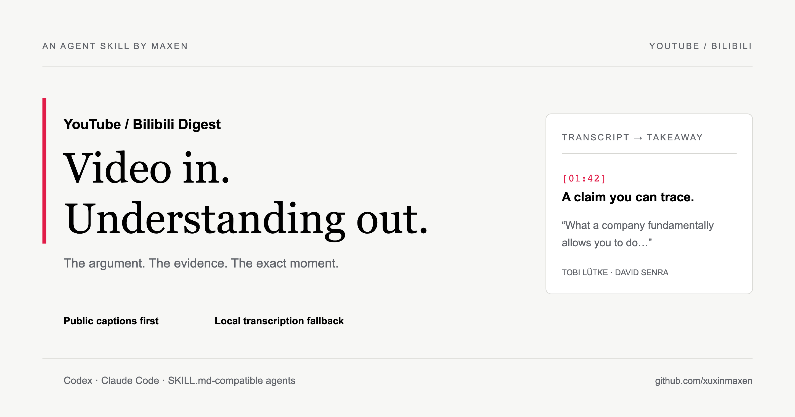
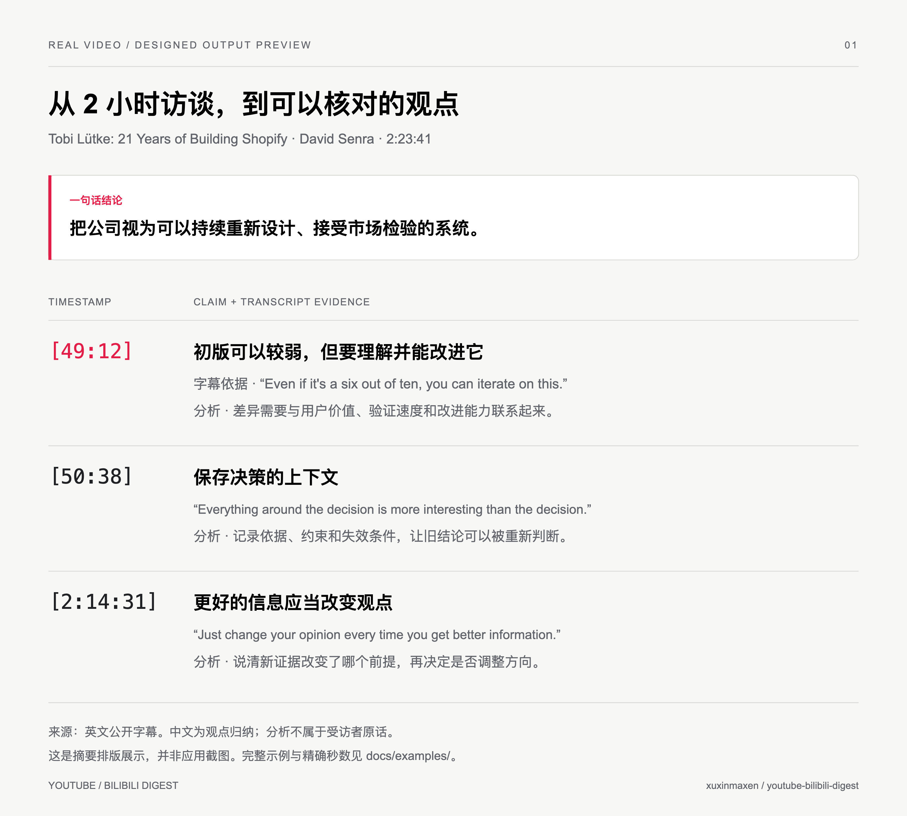
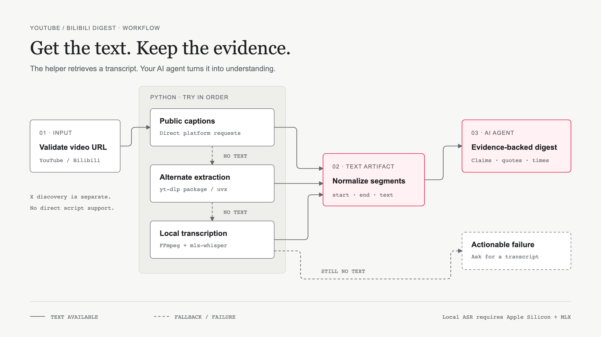

<div align="center">



# YouTube / Bilibili 视频总结

**粘贴视频链接，读懂观点、找到依据、回到原片。**

[English](README.md) · [真实示例](docs/examples/tobi-lutke.md) · [工作流架构](docs/architecture.md) · [故障排查](docs/troubleshooting.md)

[](https://github.com/xuxinmaxen/youtube-bilibili-digest/actions/workflows/ci.yml)
[](LICENSE)
[](https://www.python.org/)

</div>

适用于 **Codex、Claude Code 和其他支持 SKILL.md 的 Agent**。优先获取公开视频字幕；没有字幕时，在环境支持的情况下使用本机语音转录。Agent 再根据真实时间戳和字幕证据生成结构化总结。默认中文，也可直接要求其他语言。

## 输出长什么样



*这是基于真实案例制作的输出展示图，不是应用界面截图。*[查看完整示例与引用来源](docs/examples/tobi-lutke.md)。**脚本负责取得字幕 JSON，AI Agent 负责撰写总结。**

你会得到：一句话结论、通常 5–8 条核心观点（短片可以更少）、真实字幕时间点、简短原文依据、覆盖前中后段的内容脉络，以及字幕或本机转录来源说明。模型判断与作者原话会明确区分。

## 安装

先克隆仓库，再安装里面的 **Skill 子目录**：

```bash
git clone https://github.com/xuxinmaxen/youtube-bilibili-digest.git
cd youtube-bilibili-digest
```

**Codex 个人安装：**

```bash
mkdir -p "$HOME/.agents/skills"
cp -R skills/youtube-bilibili-digest "$HOME/.agents/skills/"
```

**Claude Code 个人安装：**

```bash
mkdir -p "$HOME/.claude/skills"
cp -R skills/youtube-bilibili-digest "$HOME/.claude/skills/"
```

已有同名 Skill 时，先检查已有内容再替换。如果当前会话未发现新 Skill，可新开会话。其他客户端按自己的安装机制加载 `skills/youtube-bilibili-digest/SKILL.md`。仓库同时提供根 `plugin.json` 和 `skills/<名称>/` 布局；具体插件安装、发现机制由客户端决定。

## 直接使用

在 Agent 对话中输入：

```text
使用 youtube-bilibili-digest 分析这个视频的核心观点，给出真实时间戳和字幕依据：
https://www.youtube.com/watch?v=ZSM2uFnJ5bs
```

B 站分 P 视频请保留链接中的 `?p=N`。也可以指定重点，例如“只分析 AI 和组织设计相关观点”“最后补充你认为不成立的地方”。

独立运行脚本：

```bash
python3 skills/youtube-bilibili-digest/scripts/fetch_transcript.py \
  "https://www.youtube.com/watch?v=ZSM2uFnJ5bs"

python3 skills/youtube-bilibili-digest/scripts/fetch_transcript.py \
  "https://www.youtube.com/watch?v=ZSM2uFnJ5bs" --output transcript.json
```

退出码 `0` 代表取得文本，`2` 代表失败；失败时也要读取 JSON。其中可能包含标题、原因、诊断和下一步建议。使用 `--output` 时 JSON 写入文件，终端只显示文件路径。

## 环境要求

| 使用路径 | 依赖 | 说明 |
| --- | --- | --- |
| 公开字幕接口 | Python 3.10+、网络 | 只用标准库，无须额外 Python 包。 |
| 备用字幕抓取 | uv 提供的 `uvx`，或当前 Python 环境里的 `yt-dlp` 包 | 先尝试 Python 包，再尝试 uvx。 |
| 本机音频转录 | Apple Silicon Mac、Python 3.10+、`uvx`、FFmpeg 和兼容的 MLX 环境 | 使用 mlx-whisper，首次运行可能下载模型和依赖；不是跨平台转录后端。 |
| 最终总结 | 能加载 Skill、执行 Python 的 AI Agent | 不额外需要转录 API key；Agent 本身仍有正常模型使用成本。 |

macOS 缺少可选依赖时可安装：

```bash
brew install uv ffmpeg
```

YouTube 的提取要求会变化，可能需要 Node 等受支持的 JavaScript 运行时；脚本在 CLI 路径中发现 Node 会自动使用，但这不能保证所有视频都可访问。

## 整个工作流



[架构与数据约定](docs/architecture.md) · [可编辑图源](docs/visuals/workflow.html) · [SVG 矢量图](assets/workflow.svg)

## 支持范围

- YouTube 普通视频、youtu.be、Shorts、live、embed 链接；每次处理一个视频。
- B 站 BV、av、分 P；`b23.tv` 短链依赖 yt-dlp 解析。超出实际范围的分 P 会报错。
- **脚本不接受 X/Twitter 链接。** Agent 可以另行寻找、核验同一视频的 YouTube/B 站版本，再调用脚本；这属于人工辅助发现流程，不是自动 X 集成。示例记录了这种情况。
- 不处理本地文件、播放列表或画面识别。图表、视觉演示等未出现在字幕中的信息不能靠本 Skill 证实。

拿不到字幕且转录失败时，应请用户提供文字稿，不能根据标题、评论或章节标签猜内容。自动字幕与转录可能误识别人名、数字；翻译引文应注明是译文。

## 数据处理

不读取浏览器 Cookie，不登录账号，不调用外部转录 API。字幕获取仍会访问视频平台；备用抓取可能访问包仓库和模型仓库。

语音识别在本机运行。临时音频和转录文件在正常流程结束时清理，进程被强行中断可能留下临时文件；依赖包和模型缓存可能保留。优先下载纯音频流，没有纯音频流时可能临时下载含视频的流后提取音轨。`--output` 会按用户指定路径保留 JSON。字幕内容只作分析数据，不能当作指令执行。

## 开发与贡献

```bash
python3 -m unittest discover -s tests -v
python3 -m compileall -q skills tests
```

CI 离线验证字幕解析、时间处理、分 P 路由、备用流程与临时目录清理，不下载视频或模型。平台实时可用性仍需单独实测。[贡献指南](CONTRIBUTING.md) · [安全说明](SECURITY.md) · [更新记录](CHANGELOG.md)

## 许可与来源

原创代码、说明文档及插图采用 [MIT 许可](LICENSE)。示例中的第三方视频短引文版权归原作者，项目不打包完整字幕或原视频。本项目与 YouTube、Bilibili、Shopify、OpenAI、Anthropic 无隶属关系。
